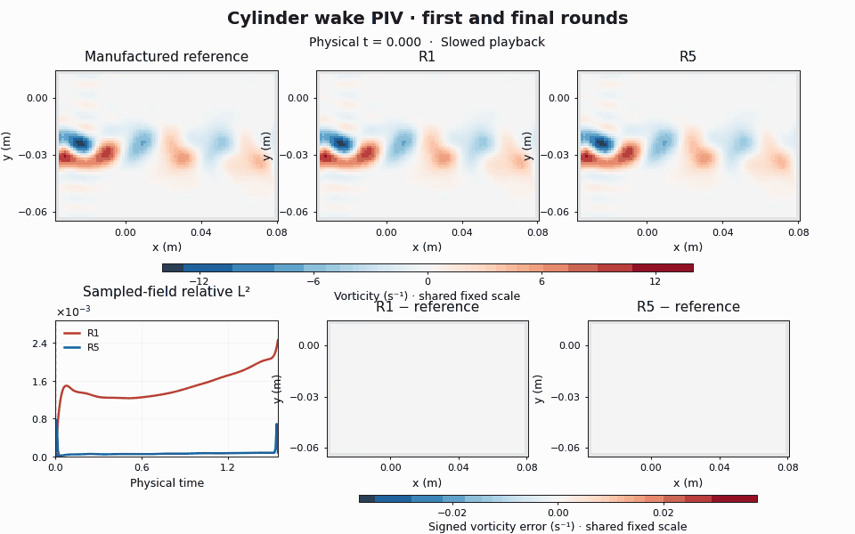
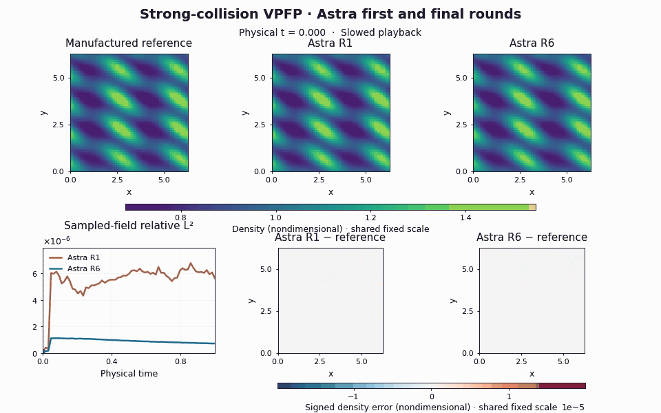

# PDE-GAV

PDE-GAV lets agents develop scientific programs in a queryable PDE environment. Choose an equation, task, and dataset, then configure a multi-round run. Agents acquire cases, query public inputs, evaluate programs, and improve their code. The system records each round and delivers a solver, reduced-order model, statistics program, or custom scientific program.

Extend the system through **PDE plugins and experiment configurations**. The shared Controller manages rounds, budgets, selection, logs, parallel execution, and recovery.

## Solver demos

**Navier–Stokes: cylinder-wake PIV.** Vorticity from first-round R1 and final-round R5 solvers on the same PIV-derived manufactured case.



**Strong-collision VPFP: Astra.** Density from first-round R1 and final-round R6 solvers on the same generated manufactured case.



The upper row shows the reference and both predictions; the lower row shows error curves and error maps. Color scales are fixed across time and both rounds, and playback is slowed. Relative L2 errors describe the displayed field on one case, not aggregate benchmark scores.

## Run a complete example

From the repository root:

```bash
python -m venv .venv
source .venv/bin/activate
python -m pip install -e '.[test]'
python examples/toy_campaign.py
```

This three-round Poisson example runs on CPU with two deterministic demonstration agents. It requires no model account or external data. Its output includes `status: completed`, the selected program for each round, and terminal evaluation results. Install additional scientific dependencies with `python -m pip install -e '.[scientific]'` when needed.

Open the Toy panel to configure another example run and inspect its results:

```bash
python -m pde_agent_verifier_solver panel
```

This command opens the Toy project by default. To use your own PDE, bind its plugin, data, and execution services through `ProgramBundle` and `PanelController`; see [connecting the panel](src/pde_agent_verifier_solver/plugins/ADDING_A_PDE.md#connect-product). Plugin registration does not automatically load data, weights, or model credentials.

## Where to start

| What you want to add | What to implement or configure | What you can reuse | Instructions |
| --- | --- | --- | --- |
| An NS geometry with different obstacles, domain, or boundaries, while still producing a velocity-field solver | Geometry and public boundary data, matching cases and Generator, NS launcher arguments | NS Task, evaluation interfaces, Controller, agent execution | [New NS geometry](src/pde_agent_verifier_solver/plugins/ADDING_A_PDE.md#ns-geometry) |
| A new objective for an existing PDE, such as drag prediction, ROM, or statistics | A Task, its evaluator, instructions, and result display; additional reference quantities if needed | Existing Problem and compatible Generator | [New Task](src/pde_agent_verifier_solver/plugins/ADDING_A_PDE.md#new-task) |
| A new PDE | Problem, Generator, public Oracle, private reference, Task, evaluator, and plugin registration | Run engine, agent tools, budgets, selection, recovery, and panel components | [New PDE](src/pde_agent_verifier_solver/plugins/ADDING_A_PDE.md#new-pde) |

**Integration guide: [Adding a geometry, Task, or PDE](src/pde_agent_verifier_solver/plugins/ADDING_A_PDE.md).** Follow the relevant route, then complete its [minimum verification](src/pde_agent_verifier_solver/plugins/ADDING_A_PDE.md#verify-integration).

A Task describes what the final program must do. Changing geometry can reuse the same Task. Markdown describes the task and available resources; new mathematical inputs, Oracle behavior, or scoring rules still require plugin implementations.

## Repository layout

| Directory | Responsibility |
| --- | --- |
| [sdk/](src/pde_agent_verifier_solver/sdk/) | Problem, Generator, Task, Case, evaluation, and public-input interfaces. Start with [programs.py](src/pde_agent_verifier_solver/sdk/programs.py) and [evaluation.py](src/pde_agent_verifier_solver/sdk/evaluation.py) |
| [plugins/](src/pde_agent_verifier_solver/plugins/) | PDE-specific science. [toy.py](src/pde_agent_verifier_solver/plugins/toy.py) is a minimal complete example; [NS](src/pde_agent_verifier_solver/plugins/ns/) demonstrates continuous-input solvers and includes external PDE-agent [baseline integrations](src/pde_agent_verifier_solver/plugins/ns/baselines/README.md); [VPFP](src/pde_agent_verifier_solver/plugins/vpfp/product.py) demonstrates multiple Tasks for one equation |
| [engine/](src/pde_agent_verifier_solver/engine/) | Controller, rounds, agent and candidate execution, parallelism, selection, logs, and recovery |
| [app/](src/pde_agent_verifier_solver/app/), [panel/](src/pde_agent_verifier_solver/panel/), [web/](web/) | Projects, runs, configuration forms, progress, and results |
| [configs/](configs/README.md), [scripts/](scripts/) | Configuration examples, PDE entry points, cluster launchers, and verification scripts |
| [legacy/](legacy/) | Numerical backends and historical adapters still used by some plugins, including parts of NS geometry and differentiation |
| [tests/](tests/) | Interface, scientific, and end-to-end verification examples |
| [docs/](docs/) | Shared-module, parallel-evaluation, GPU-protocol, Plasma-integration and [site configuration](docs/SITE_CONFIGURATION.md) guides |

## Configure a scientific experiment

1. Choose the PDE plugin and Task. Define public inputs, the program to deliver, and the error metric.
2. Prepare matching data, Generator assets, and reference cases. Bind their actual paths in the experiment configuration.
3. Organize agent instructions into task, resources, and research-role Markdown sections; see [prompt and module configuration](docs/MODULE_INTEGRATION.md). The plugin supplies scientific and tool interfaces; the run configuration supplies budgets.
4. Configure agents, rounds, full wall-clock budgets, case acquisition, selection, and terminal evaluation. Starter cases, Generator training data, and hidden evaluation cases are separate settings.
5. Verify case acquisition, solving, scoring, and round transitions on a small run before scaling up. Keep experiment configurations and outputs in a separate experiment directory.

Large datasets, weights, and full execution archives live outside this repository. Published experiment packages include selected source and result records; see the [VP / VPFP release](configs/paper/plasma_transport_v2/README.md). Historical configurations and launchers refer to external resources through the placeholders described in [site configuration](docs/SITE_CONFIGURATION.md); bind your own paths, Slurm account, and model credentials before running them.

Files such as `ns_canonical_structured_5round.json` are retained configuration examples with historical parameters. Generate new run configurations from the agreed protocol. The `experimental_piv` example performs sparse-observation reconstruction; the paper's measured-data NS solver uses `experimental_mms`. These are different Tasks.

New synthetic NS main experiments use matching v6 assets and construction. Online templates start each round with zero development cases and set the cumulative acquisition limit to `null`. Agents acquire cases within their full wall-clock budgets. The Fixed arm has a separately configured development bank.

## Runtime capabilities

| Capability | Current behavior and documentation |
| --- | --- |
| Per-case feedback | Development evaluation returns per-case errors and metrics. Solver exceptions include messages, tracebacks, and code locations. Scalar feedback does not disclose hidden answers or scoring coordinates |
| Program selection | New NS templates require each agent to explicitly choose one primary candidate using `submit --primary` or `select-primary`. Ordinary submissions save versions. Historical `all/latest` policies remain available through their configurations |
| CPU/GPU execution | Solvers may use CPU, GPU, or both. In the four-GPU NS layout, each agent's GPU executes its development evaluations, and the Oracle GPU serves both agents. Official and terminal evaluations have their own device assignment; see [parallel evaluation](docs/PARALLEL_EVALUATION.md) |
| Batch solving | Optional `prepare_solutions` and cross-case queries support batch computation. One evaluation may contain dozens of cases; NS templates split them into batches of eight. The solver and plugin must implement batch computation; a single-case algorithm is not automatically vectorized |
| Prompts and resources | Task, resource, and role Markdown files are composable. Agents can consult online resources. Complete prompts and research logs are saved per round; see [module integration](docs/MODULE_INTEGRATION.md) |
| Model-service recovery | Managed Agent rounds retry temporary capacity, rate-limit, network, and service errors in the same session until the original wall-clock deadline. Waiting counts toward that budget; service silence is detected without interrupting active tools, and the panel shows recovery progress. See [recovery settings](docs/MODULE_INTEGRATION.md#temporary-model-service-failures) |
| Loading and recovery | Submitted program identifiers are reused. Relevant loading, copying, and recovery paths avoid repeated checksum scans while retaining necessary path, shape, and numerical handling |

These are supported capabilities. Acceptance of a particular formal experiment is established by that run's verification records. A new PDE plugin still supplies its numerical Oracle, MMS construction, Guidance, Perturbation, and GPU kernels.

## VPFP and Artemis integration

The [published VP / VPFP experiment package](configs/paper/plasma_transport_v2/README.md)
contains the latest six-round protocol, six original run configurations, all
77 archived program bundles, final S6 links, and native and independent
validation tables through October 21, 2026. It records the actual selection
subsets, two first-round exceptions, and original failures alongside declared
supplements. The package follows the NS configuration and candidate-bundle
layout and can be checked without running an experiment.

NS, strong/weak VPFP, and Artemis share the same Controller and candidate execution service. Each PDE supplies its scientific interfaces and chooses its own protocol; adding Plasma features does not change NS scoring or frozen experiments.

- **Plasma campaigns:** strong VPFP, weak VPFP, and Artemis each provide Sol-max and Astra-ultra configurations, explicit primary selection, GPU execution, and bounded Slurm continuation. Plasma currently uses single-case workers until its Tasks implement batch solving; NS supports batches of eight. See [Plasma integration](docs/PLASMA_INTEGRATION.md).
- **Optional transport scoring:** `plasma_macro_transport_v2` reports density, electric-field, particle-flux, centered-pressure, and centered-heat-flux errors, weighted 1/8, 1/8, 1/4, 1/4, and 1/4. Its scales come from independently calibrated references, not candidate results. Existing protocols remain separate. CPU tests do not replace the required GPU calibration and family-specific acceptance runs; see [transport scoring](docs/PLASMA_INTEGRATION.md#shared-plasma-macro-transport-v2).
- **Shared Oracle transport:** public queries and results can use inline arrays and transient sidecars. Trusted numerical results avoid repeated value scans; batch queries, timing traces, and per-agent GPU routing use the same transport.
- **Cross-site transfer tools:** `tools/build_plasma_transfer_spec.py`, `tools/plasma_transfer_manifest.py`, and `tools/plasma_git_snapshot.py` build sealed manifests of the data, weights, and exact source snapshots a deployment depends on. They do not submit jobs or copy credentials.
- **Restricted-namespace host compatibility:** the shared Agent configuration explains how to edit inside the existing authorized workspace on hosts whose user-namespace limit breaks native file tools. This does not alter sandbox permissions, networking, GPU allocation, or budgets; see [module integration](docs/MODULE_INTEGRATION.md#restricted-namespace-host-compatibility).

## Development checks and historical reproduction

Run the minimum product checks:

```bash
python -m pytest tests/test_toy_product_flow.py tests/test_evaluator_contract.py
```

Add scientific examples for your new module. `make test` covers a broader set of shared flows; the [integration guide](src/pde_agent_verifier_solver/plugins/ADDING_A_PDE.md#verify-integration) lists acceptance criteria.

The frozen paper code, data, weights, programs, and results are kept in the authors' experiment archive outside this repository. Reproduce historical v5/v6 configurations with their original versions, binding the archive and run locations through the documented placeholders. Run new research in separate directories.
